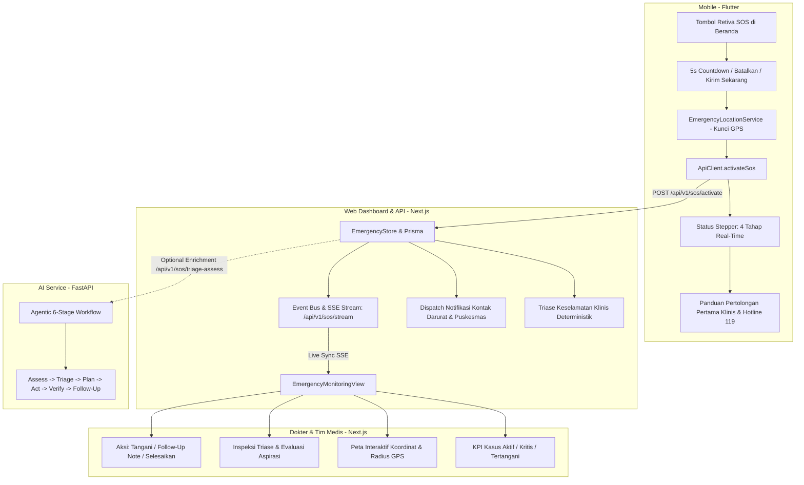

# Retiva SOS — Agentic Emergency Response System
## Dokumentasi Arsitektur, Implementasi, & Panduan Verifikasi

Sistem **Retiva SOS** adalah modul kedaruratan terpadu untuk pasien diabetes dan retinopati diabetik yang menghubungkan aplikasi seluler pasien (Flutter), pusat monitoring dokter dan fasilitas kesehatan primer Puskesmas / RS Mata (Next.js), sistem database & ORM (PostgreSQL & Prisma), serta layanan Agentic AI (FastAPI).

---

### 1. Ringkasan Implementasi Arsitektur



---

### 2. Berkas yang Diimplementasikan & Diubah

| Komponen | Berkas | Deskripsi |
| :--- | :--- | :--- |
| **Prisma Schema** | `web/prisma/schema.prisma` | Penambahan model `EmergencyIncident`, `EmergencyContact`, `EmergencyNotification`, `EmergencyIncidentEvent`, `EmergencyFollowUp`, serta enum `EmergencyIncidentStatus` dan `EmergencyUrgencyLevel`. |
| **Database Store** | `web/infrastructure/database/emergency-store.ts` | Store data tangguh dengan fallback in-memory global, simulasi faskes Yogyakarta (Puskesmas Sleman/Jetis), aturan triase deterministik, dispatch notifikasi, dan event bus SSE. |
| **API Backend** | `web/app/api/v1/sos/activate/route.ts` | Endpoint aktivasi SOS dari mobile/klien dengan proteksi duplikasi (20s rate-limit), timeout aman pemanggilan AI, dan dispatch instan. |
| **API Backend** | `web/app/api/v1/sos/incidents/route.ts` | Endpoint listing insiden darurat dengan filter status, urgensi, pencarian live, dan statistik agregat. |
| **API Backend** | `web/app/api/v1/sos/incidents/[id]/route.ts` | Endpoint GET detail insiden dan PATCH untuk acknowledgment dokter, catatan tindak lanjut, dan resolusi. |
| **API Backend** | `web/app/api/v1/sos/contacts/route.ts` | Endpoint pengelolaan kontak darurat keluarga terverifikasi (GET, POST, DELETE). |
| **API Backend** | `web/app/api/v1/sos/stream/route.ts` | Endpoint Server-Sent Events (SSE) dengan heartbeat 15s untuk sinkronisasi live tanpa polling berlebih. |
| **Dashboard UI** | `web/components/EmergencyMonitoringView.tsx` | Tampilan monitoring darurat dokter: KPI card, daftar panggilan live, peta OpenStreetMap interaktif, audit trail kejadian, peringatan bahaya aspirasi, dan modal catatan medis. |
| **Sidebar & Shell** | `web/components/AdminSidebar.tsx` & `ClinicalDashboardShell.tsx` | Menu navigasi "Monitoring SOS" dengan indikator badge merah aktif `activeSosCount` dan rendering dinamis tab `sos-monitoring`. |
| **AI Service** | `ai-service/app/schemas/sos.py` | Skema Pydantic `SOSTriageRequest` dan `SOSTriageResponse` terstruktur. |
| **AI Service** | `ai-service/app/api/routes/sos.py` | Implementasi 6 tahapan Agentic Emergency Response dengan gating klinis ketat (PERKENI & PERDAMI). |
| **AI Service** | `ai-service/app/api/routes/__init__.py` | Pendaftaran router SOS ke FastAPI application. |
| **Mobile Dart** | `mobile/lib/data/models/sos_incident_model.dart` | Model data Dart `SosIncidentModel`, `SosNotificationModel`, dan `EmergencyContactModel`. |
| **Mobile Dart** | `mobile/lib/core/services/emergency_location_service.dart` | Service telemetri lokasi GPS dengan timeout 3.5s dan fallback koordinat Sleman/Yogyakarta. |
| **Mobile Dart** | `mobile/lib/core/network/api_client.dart` | Penambahan method `activateSos()`, `getEmergencyContacts()`, dan `cancelSos()`. |
| **Mobile Dart** | `mobile/lib/presentation/screens/sos_activation_screen.dart` | Layar aktivasi SOS mobile dengan hitungan mundur 5 detik, tombol cancel, stepper status real-time, panduan medis, dan hotline 119 manual. |
| **Mobile Dart** | `mobile/lib/presentation/screens/home_screen.dart` | Kartu darurat SOS siaga di beranda pasien dan Floating Action Button SOS merah mencolok. |
| **Mobile Dart** | `mobile/lib/main.dart` | Penanganan route intent Android `sos_activation`. |
| **Android Native** | `mobile/android/app/src/main/kotlin/com/example/retiva_mobile/MainActivity.kt` | MethodChannel `com.example.retiva/emergency_location` dan intent action `ACTION_OPEN_SOS`. |
| **Android Native** | `mobile/android/app/src/main/AndroidManifest.xml` | Deklarasi izin `ACCESS_FINE_LOCATION`, `ACCESS_COARSE_LOCATION`, `INTERNET`, dan intent filter SOS. |
| **Pengujian** | `web/scripts/test-sos.ts` | Test suite otomatis end-to-end mencakup 22 assertion klinis dan fungsional. |

---

### 3. Aturan Triase Klinis Deterministik (Clinical Safety Gating)

Dalam implementasi Retiva SOS, kecerdasan buatan (LLM) tidak pernah diizinkan mengambil keputusan di luar batasan klinis. Aturan deterministik berikut dikunci secara mutlak:

1. **Pasien Tidak Sadar / Penurunan Kesadaran / Kejang / Gangguan Menelan Akut:**
   - **Tingkat Urgensi:** `CRITICAL`
   - **LARANGAN MUTLAK (Strict Rule):** `oralFoodAllowed = false`. Dilarang keras memasukkan makanan, minuman, air gula, atau permen ke dalam mulut pasien karena risiko fatal **aspirasi paru (asphyxiation/pneumonitis)**.
   - **Tindakan Otomatis:** Panduan baring posisi miring mantap (*Recovery Position*) dan aktivasi panggilan Ambulans SPGDT 119 segera.

2. **Kedaruratan Retinopati Akut (Curiga Ablasio Retina / Vitreous Hemorrhage):**
   - **Gejala Khas:** Penglihatan tertutup bayangan tirai hitam mendadak, fotopsia (kilatan cahaya), atau bertambahnya floaters drastis.
   - **Tingkat Urgensi:** `HIGH`
   - **Tindakan Otomatis:** Rujukan prioritas ke IGD Rumah Sakit Mata (contoh: RS Mata Dr. YAP Yogyakarta) dalam kurun waktu `< 24 jam`. Pasien diinstruksikan tirah baring posisi kepala tenang dan dilarang menggosok bola mata.

3. **Hipoglikemia Simptomatik dengan Kesadaran Penuh & Aman Menelan:**
   - **Tingkat Urgensi:** `CRITICAL` (jika <54 mg/dL) atau `HIGH` (jika <70 mg/dL).
   - **Protokol:** Penerapan **Rule 15-15** (pemberian 15 gram glukosa cepat serap seperti 1 sdm madu atau 150ml teh manis hangat, istirahat, dan evaluasi ulang kadar gula darah setelah 15 menit).

---

### 4. Hasil Verifikasi & Pengujian Otomatis

Pengujian end-to-end dijalankan melalui perintah `npm run test:sos` di direktori `web`:

```text
==================================================
🧪 RETIVA SOS — AGENTIC EMERGENCY SYSTEM TEST SUITE
==================================================

--- 1. Testing Initial Seed Incidents & Stats ---
✅ PASS: Retrieved 2 initial incidents
✅ PASS: Initial stats has 2 total cases
✅ PASS: Initial stats has 1 active cases

--- 2. Testing Clinical Safety Rule: Unconscious Patient ---
✅ PASS: Unconscious patient classified as CRITICAL
✅ PASS: CRITICAL RULE: Oral food/drink strictly FORBIDDEN (Aspiration Hazard)
✅ PASS: CRITICAL RULE: Requires urgent Ambulance 119 dispatch
✅ PASS: Warning flag includes Aspiration Hazard

--- 3. Testing Clinical Safety Rule: Conscious Hypoglycemia ---
✅ PASS: Hypo classified as HIGH or CRITICAL
✅ PASS: Conscious patient CAN safely take oral carbohydrate
✅ PASS: Immediate action specifies Rule 15-15 protocol

--- 4. Testing Clinical Safety Rule: Acute Retinal Emergency ---
✅ PASS: Retinal incident requires Eye Specialist (<24h)
✅ PASS: Risk identified as Retinopati / Ablasio Retina

--- 5. Testing Responder Workflow (Acknowledge -> Note -> Resolve) ---
✅ PASS: Incident status successfully transitioned to ACKNOWLEDGED
✅ PASS: acknowledgedAt timestamp recorded
✅ PASS: Follow-up note recorded successfully
✅ PASS: Incident successfully transitioned to RESOLVED
✅ PASS: resolvedAt timestamp recorded

--- 6. Testing Emergency Contacts ---
✅ PASS: Default fallback contacts provided if none registered
✅ PASS: New emergency contact created
✅ PASS: Contact retrieved for patient
✅ PASS: Contact deleted successfully

--- 7. Testing Real-time Event Bus ---
✅ PASS: Realtime subscriber received event broadcast

==================================================
TEST RESULTS: 22 PASSED, 0 FAILED
==================================================
```

Pemeriksaan kompilasi TypeScript (`npx tsc --noEmit`) pada Next.js menghasilkan **0 kesalahan (Exit code 0)**.

---

### 5. Panduan Menjalankan & Verifikasi Manual

#### A. Menjalankan Web Dashboard Dokter / Admin
```bash
cd web
npm run dev
```
1. Buka `http://localhost:3000` di peramban.
2. Masuk sebagai Dokter atau Admin.
3. Klik menu **Monitoring SOS** pada bilah sisi kiri (terdapat badge merah berkedip bila terdapat panggilan darurat aktif).
4. Klik salah satu insiden dari daftar di sisi kiri:
   - Periksa koordinat GPS pada peta OpenStreetMap interaktif.
   - Amati ringkasan evaluasi triase AI dan instruksi keselamatan klinis.
   - Tekan tombol **Tangani Insiden (Acknowledge)** untuk menugaskan dokter penanggung jawab.
   - Tekan tombol **Tambah Catatan** untuk menambahkan observasi klinis.
   - Tekan tombol **Tandai Selesai** untuk menutup kedaruratan.

#### B. Menjalankan Backend AI Service (FastAPI)
```bash
cd ai-service
uvicorn app.main:app --host 0.0.0.0 --port 8003 --reload
```
Endpoint `/api/v1/sos/triage-assess` siap melayani triase terstruktur 6-tahap.

#### C. Menjalankan Aplikasi Mobile Pasien (Flutter)
```bash
cd mobile
flutter run
```
1. Pada Beranda, perhatikan **Kartu Siaga Retiva SOS** dan **Floating Action Button SOS Darurat**.
2. Tekan tombol SOS:
   - Hitungan mundur 5 detik muncul dengan opsi **Batalkan Peringatan** (bila tidak sengaja tertekan).
   - Atau tekan **Kirim Sekarang** untuk langsung menyiarkan darurat.
   - Amati stepper 4-tahap: Menyiapkan Alert ➔ Mengunci GPS ➔ Mengirim Notifikasi ➔ Terkirim & Terverifikasi.
   - Bila pasien tidak sadar, kartu peringatan larangan asupan oral akan muncul dengan instruksi pertolongan pertama serta tombol panggil cepat **Ambulans 119 SPGDT** dan **RS Mata Dr. YAP**.
